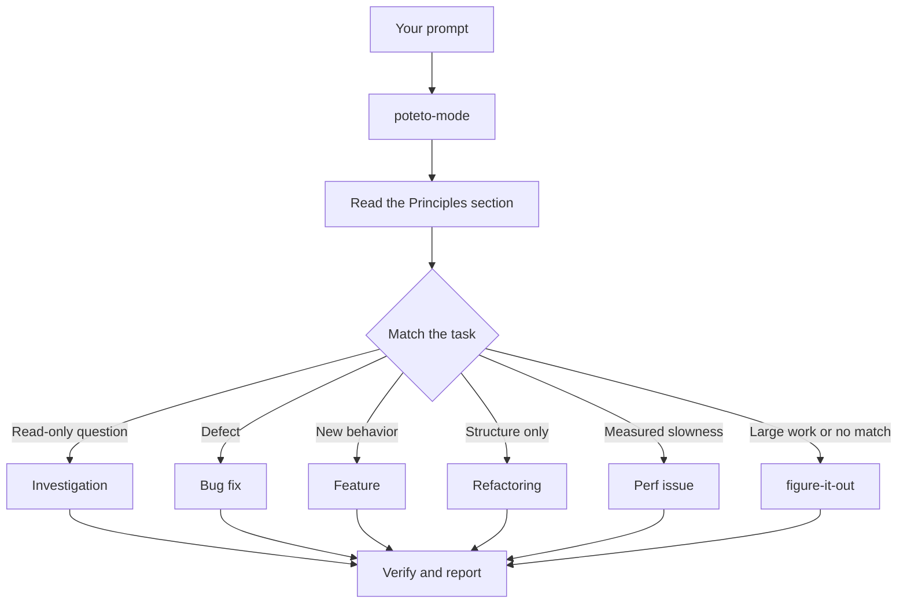

# 通过 `/poteto-mode` 分派工作

[English](../guide/02-poteto-mode.md) | **中文**

<!-- translated-from: 02-poteto-mode.md sha256:07e50287650b4e22ea91bbbcd2da9599689e6a295fd576d8358d6bf95eb3181a -->

`/poteto-mode` 是入口。你给它一个目标，它会从二十二个 playbook 里匹配一个，把那个 playbook 的步骤复制进待办清单，并按步骤需要调用其它 skill。这一页讲好的 prompt 是什么样，以及你其实只需要写多少。


<a id="what-happens-to-your-prompt"></a>

## 你的 prompt 会经历什么



图里画的是常见的路线。另外还有这些 playbook：逐步优化某个指标（hillclimbing）、诊断运行时症状和抓取到的 trace、原型、视觉一致性、编写和评估 skill、自主运行、开 PR、看护一个 PR 或一组叠加的 PR（stack）直到可以合并、交付一组已验证的 stack、用 autopilot 方式处理 PR 队列或 stack、接手会话、安全暂停、多阶段计划，以及清理 worktree。完整列表见 [playbook 目录](../../plugins/pstack/skills/poteto-mode/playbooks/)。

<a id="say-the-goal-not-the-ceremony"></a>

## 说目标，不走形式

你不用写规格文档。你说哪里不对，或者你想要什么，再加上你已经知道、能帮 agent 省时间的信息：

```text
/poteto-mode users get two notifications after a retry. repro first, then fix and verify.
```

这就是一条 Bug fix prompt。“repro first”（先复现）是真实的约束，不是客气话，playbook 会遵守它。留意待办清单里填进 Bug fix 的步骤。

<a id="what-goes-in-a-prompt"></a>

## prompt 里写什么

一条有用的 prompt 最多包含五样东西，每样一句话就能说清：

- **目标。** 说哪里不对，或者你想要什么。
- **完成检查。** 它必须能判定通过或失败。“把它弄好一点”和“在上面干一个小时”都不是检查。
- **你想看到的证据。** 要求看真实的命令输出、操作流程的视频、存下来的值，或者前后对比的数字。
- **你已经知道的信息。** 一个症状、一个复现步骤、一行日志或一个链接，都能帮 agent 省掉一次搜索。
- **真实的约束。** “repro first”、“don't change any code yet”（先别改代码）、“zero behavior change”（行为零变化）和 “let me review before proceeding”（继续之前先让我看看）都会改变 agent 的做法。

下面这条 prompt 五样都有：

```text
/poteto-mode the csv export drops its last row since yesterday's deploy. failing job id is 4812. repro first, then fix. done means the 60k-row fixture exports every row. show me the row counts before and after.
```

有两样东西最好不写：

- **怎么做。** 说要达成什么，给 agent 留出空间，去找比你会选的更好的路。一串 skill 列表也一样，见下面的坑。
- **你对原因的猜测，至少一开始别说。** 说出来的猜测会把搜索范围缩到你指的地方。先让 agent 复述问题，再说出你的直觉。

遇到信息杂乱的报告，比如一条很长的讨论串或一个含糊的 bug，就把复述作为第一步：

```text
/poteto-mode read this thread. restate the underlying issue in your own words, in plain english. don't change any code yet.
```

理解偏差会在复述里暴露出来，那时还没有写任何代码。在那里纠正，只花你一条消息，而不是一次错误的修复。如果只想要复述、不走 playbook，运行 [`/in-your-own-words`](../../plugins/pstack/skills/in-your-own-words/SKILL.md)。它会复述 agent 认为你的目标是什么，以及你想解决什么问题。

不确定一条 prompt 是否瞄准对了时，发送之前先对它运行 [`/sharpen`](../../plugins/pstack/skills/sharpen/SKILL.md)：

```text
/sharpen write a migration guide for the v2 config format.
```

agent 会说出：顶尖的专业人士会做哪些你没要求的事，他们会从哪些最原始的材料入手，会用什么方法和工具，以及除了你和 agent 之外，还有什么能证明结果是对的。然后它改写你的 prompt，让它正好要求这些，更深入，但不更庞大。改写后的 prompt 会要求 agent 对任何能用实验解决的选择先做原型，并根据观察到的结果推荐一个方案；产品和偏好上的选择则留给你。它不会去做这个任务。读一读改写后的版本，然后发送，比如用 `/poteto-mode` 发送。

<a id="follow-up-short"></a>

## 后续消息要短

当对话里已经有了上下文，prompt 可以缩到几乎没有。下面每一条都够用：

```text
/poteto-mode do it
```

```text
continue
```

```text
keep going until done
```

短之所以管用，是因为 playbook 承载了结构，而会话启动 hook 会在整个会话里持续把较大的任务交给 `/poteto-mode`。[安装 pstack](./01-setup.md#run-your-first-task) 说明了它会分派哪些任务。你的话负责传达意图，skill 负责严谨。

<a id="switch-tasks-with-new-task"></a>

## 用 “new task” 切换任务

很长的对话会积累上一个任务的上下文。换话题时，要说出来：

```text
/poteto-mode new task. figure out why the cache entry survives logout. don't change any code yet.
```

“new task”（新任务）告诉 `/poteto-mode` 重新匹配，而不是继续之前的 playbook。“don't change any code yet” 把这一次固定在 Investigation 上。没有这两句话，一个正做到 Feature 中途的 mode 往往会把你的问题当成下一个功能步骤。

<a id="give-parallel-work-its-own-machine"></a>

## 给并行工作单独的机器

如果你在一台电脑上让好几个 agent 同时处理同一个仓库，它们会争抢工作区、端口和构建输出。最干净的隔离方式，是在各自 worktree 里运行的后台子 agent。每个都有自己的 checkout 和分支，所以可以安装依赖、运行你的应用、检查结果，而不碰你的工作区。让父级对话把工作交给这样的子 agent。

如果工作必须留在本地，就一开始要求用 worktree：

```text
/poteto-mode new task. branch off <base> in a fresh worktree, then port the parser change there.
```

每个任务都有自己的分支和 worktree，就不会有 agent 踩到别人的文件。worktree 占用磁盘和机器资源，所以一台笔记本同时只能跑几个。[Opening a PR playbook](../../plugins/pstack/skills/poteto-mode/playbooks/opening-a-pr.md) 在改代码时本来就从 worktree 出发，所以大多数时候，只有当某个特定的 base 或位置很重要时，你才需要说这句话。

worktree 会越积越多。磁盘紧张时，这样问：

```text
/poteto-mode what's eating my disk? prune the worktrees that are safe to prune.
```

[Worktree cleanup playbook](../../plugins/pstack/skills/poteto-mode/playbooks/worktree-cleanup.md) 会按合并状态、未提交的工作，以及还有哪些对话在用它，给每个 worktree 分类。它只删除证据确认可以删的，遇到含有未提交工作的 worktree，会停下来等你决定。

<a id="leave-it-running"></a>

## 让它一直跑

你要离开时，说清楚怎样算完成，然后走开：

```text
/poteto-mode im stepping away. keep going until the migration check reports zero old callers. log your decisions.
```

你之后才会审查的工作会交给 [`/figure-it-out`](../../plugins/pstack/skills/figure-it-out/SKILL.md)，它会设计这次运行的各个阶段，并维护一份 [`/show-me-your-work`](../../plugins/pstack/skills/show-me-your-work/SKILL.md) 决定记录。[睡觉时让工作继续跑](./07-overnight.md) 完整介绍了过夜约定。

**坑**： 不要在 prompt 里列举 skill（“use /architect, then /arena, then /interrogate...”）。playbook 已经安排好了它们的顺序，手写的顺序通常会打乱或漏掉 playbook 本来会保留的步骤。只有想推翻某个具体选择时，才点名一个 skill。

完整的分派规则，请直接读 [`poteto-mode`](../../plugins/pstack/skills/poteto-mode/SKILL.md) 本身。

下一页：[改代码之前先理解它](./03-understand.md)。
