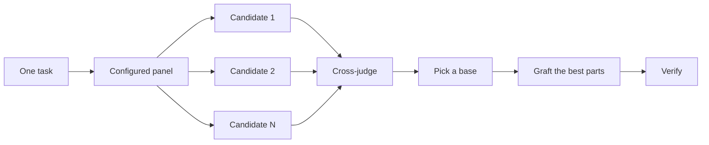

# 写代码之前先做设计

[English](../guide/04-design.md) | **中文**

<!-- translated-from: 04-design.md sha256:562113ec78d7d17e1eac6be487f6cf53cfca4251c17c023502ea96fd8525f658 -->

困难的设计只试一次，就会锁定模型最先想到的那个形状。`/architect` 在实现之前定下类型和边界。`/arena` 让同一份要求被尝试好几次，再把最好的部分合并起来。`/interrogate` 让其它模型来攻破结果。如果任务要的是覆盖面，而不是综合出一个设计，`/swarm` 会把工作拆成多个分片或多路竞赛并行跑，再汇总结果。

最常见的两个设计错误是：直接采用 agent 给出的第一个设计，以及反复打磨一份没有经过任何代码检验的计划。这一页把这两个问题都解决掉。你通过代码来做计划。原型回答悬而未决的问题，README 或教程定下目标，书面计划放在最后。


<a id="settle-the-shape-with-architect"></a>
## 用 `/architect` 定下形状

```text
/architect design the import pipeline before writing any code. i care most about how callers use it.
```

[`/architect`](../../plugins/pstack/skills/architect/SKILL.md) 先追踪这次改动涉及的每一个系统。然后它勾画出两种不同的形状，每种都有类型、函数签名和模块边界，再从中选出这样一种：每份状态只有一个所有者，每件事只有一种做法，调用方需要了解的东西最少。如果设计规模大或者有争议，它会改为运行 `/arena`，而不是自己一个人画。如果你想在写任何代码之前先看到设计，在 prompt 里说明。

代码开始写之后，设计就不再是神圣不可动的。如果同一种变通办法反复出现，`/architect` 会重新设计，而不是继续绕着它打补丁。

<a id="fan-out-attempts-with-arena"></a>
## 用 `/arena` 并行多次尝试

```text
/arena take my prompt to the arena verbatim. i want to compare their proposals with yours.
```

[`/arena`](../../plugins/pstack/skills/arena/SKILL.md) 是底层的通用工具。N 个子 agent 并行尝试同一份设计或代码要求，每个都写到自己的 worktree 或目录里。一个只读的裁判（来自另一家模型厂商）按评分标准给每个候选打分。如果没有其它厂商的模型可以运行，协调者就跳过裁判，自己挑选基础方案。协调者把每个候选从头读到尾，挑出一个作为基础，把落选方案里最好的想法嫁接进来，再验证结果。



参与的模型阵容来自你的 [`/setup-pstack`](../../plugins/pstack/skills/setup-pstack/SKILL.md) 配置，每个任务也可以单独调整。决定重要时多要几个候选，不重要时少要几个：

```text
/arena this, 5 candidates. the cache key format is expensive to change later.
```

<a id="cover-slices-and-races-with-swarm"></a>
## 用 `/swarm` 覆盖分片和竞赛

```text
/swarm check every package under packages/ against its check.sh. one worker per package. one report.
```

[`/swarm`](../../plugins/pstack/skills/swarm/SKILL.md) 把 N 个 worker 分派到互相独立的分片、覆盖矩阵、gauntlet 检查通道、探索分区，或者事先声明好的竞赛分支上。每个 worker 有自己的范围和检查，然后报告 `PASS`、`ISSUES` 或 `BLOCKED`。上层等所有 worker 完成，返回一份精简的报告，列出所有缺口或掉线的 worker。

当并行能换来覆盖面，或者能让互相独立的检查同时竞赛时，就用它。`/arena` 给每个 worker 同一份设计或代码要求，然后挑出基础方案并嫁接最好的部分。`/swarm` 覆盖各个分片，或者按事先声明的选择规则跑一场竞赛。它不走挑选基础方案、嫁接这一套流程。

<a id="break-it-with-interrogate"></a>
## 用 `/interrogate` 攻破它

```text
/interrogate the whole branch, but skeptically. no nitpicks unless it's an actual bug or regression.
```

[`/interrogate`](../../plugins/pstack/skills/interrogate/SKILL.md) 把改动和它的意图交给运行在已配置模型上的对手，每个对手都在真实代码上实际运行，试图攻破它。不同的对手会找到不同的失败。只有当重新运行它的命令确实显示出一个违背意图的失败时，一条发现才会保留下来。报告列出每一条经过验证的发现以及找到它的对手，然后列出每个对手丢弃了什么、为什么丢弃，并且不做任何修改。

Dropped（被丢弃）列表也要读。你可以推翻它的判定。

<a id="prototype-instead-of-debating"></a>
## 做原型，而不是争论

永远不要采用第一个设计。多要几个，然后根据你能看到的证据来选：

```text
/poteto-mode prototype a few options for the new dropdown menu. take screenshots or videos for me to compare.
```

[Prototype playbook](../../plugins/pstack/skills/poteto-mode/playbooks/prototype.md) 在一个临时目录里做一次性的草稿，把各个变体放在同一个切换器后面，逐个操作，并截图或记录耗时。它也适用于行为和算法，不只是 UI。原型就是用代码做计划。它让 agent 通过实际运行来回答自己的疑问，而不是来问你，还给你可能想不到的方案留出了空间。

同样的思路可以放大到真正的设计上。把 `/architect` 和原型搭配使用，并保留一个审查关口：

```text
/poteto-mode we need rate limiting for external webhooks. /architect it first, and answer open questions with prototypes. let me review before proceeding.
```

不要把对手浪费在抽象的计划上。`/interrogate` 会丢弃所有没有被运行证实的发现，所以一份背后没有代码的计划，几乎没有东西可供它们攻破。让原型解决问题，然后审查实际做出来的东西。

<a id="write-the-readme-first-for-shared-code"></a>
## 共享代码先写 README

对于会被其它代码使用的包或 API，从用户会读的文档开始：

```text
/poteto-mode write a tutorial for how i would use the new config package first. then /teach me why it beats the current one.
```

先写教程，会逼你站在调用方的角度。你向一个假想的用户描述 API，再倒推回实现。这份文档也成了一个具体的目标，agent 可以拿它来检查自己的工作。如果文档本身很重要，点名使用 [`/technical-writing`](../../plugins/pstack/skills/technical-writing/SKILL.md)，这样教程就始终是教程，不会滑向同时兼做参考手册和原理解释。

<a id="plan-after-the-design-settles"></a>
## 设计定下来之后再做计划

pstack 故意没有做计划的 skill。当你确实想要一份书面计划时，等设计定下来再要：

```text
/poteto-mode turn this design into a plan. small verifiable PRs, each with its own verification steps.
```

[Multi-phase plan playbook](../../plugins/pstack/skills/poteto-mode/playbooks/multi-phase-plan.md) 先用原型解决剩下的疑问，然后每个 PR 写一节，每节都以“这次改动确实有效”的证明结尾。光是测试套件通过，不算这种证明。计划本身就是交付物。这个 playbook 不负责实现它，只有你说开始，才会开始执行。

如果是迁移，在 prompt 里讲明标准：

```text
/poteto-mode plan the migration of our ui library to the new styling system. small verifiable PRs, each with visual regression checks. the result must match the original exactly, bugs included.
```

“bugs included”（连 bug 也一样）能防止迁移在过程中悄悄修掉一些东西，那样会让新旧输出无法比较。对于持续很多天的项目，可以暂时把计划提交到仓库里，让其它 agent 看到进行中的工作。工作合入后就把它删掉。

<a id="how-much-design-work-does-a-task-deserve"></a>
## 一个任务值得做多少设计？

你可能会想，是不是每个改动都需要这些。不是。大多数改动一样都不需要。一个粗略的阶梯：

- 一个小的、已经完成但你不太放心的改动，只需要 `/interrogate`。
- 跨越函数边界或者转移所有权的改动，值得用 `/architect`，设计规模大或有争议时它会顺带用上 `/arena`。
- 一个独立的决定，多次独立尝试会有帮助的，比如命名、格式或算法，直接用 `/arena`。
- 覆盖矩阵、一组并行检查，或者分支事先声明好的竞赛，用 `/swarm`。
- 一个能通过实际运行来回答的疑问，比如布局、耗时或做法，做原型，不要争论。
- 有争议、而且一旦定下就很难推翻的设计，先用 `/architect`，发布前再用 `/interrogate`。
- 跨越好几个 PR 的工作，要一份计划，在设计定下来之后写。

`/poteto-mode` 已经在应用这个阶梯。跨边界的工作会自动触发 `/architect`，所以你直接调用这些工具，主要是在你想要比默认更多或更少的审查时。

下一页：[构建改动，清理 diff](./05-build-and-clean.md)。
