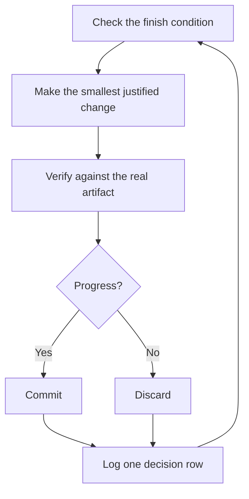

# 睡觉时让工作继续跑

[English](../guide/07-overnight.md) | **中文**

<!-- translated-from: 07-overnight.md sha256:9caba60ba4862955350a78a711a0d8e4e4126024d3a23ad98e3d6c3ad0126965 -->

前面所有内容的回报都在这里。一个你信得过、会自己验证工作的 agent，就是一个可以独自去做难题的 agent。让这件事安全的不是运气，而是三样东西：一个能检查的完成条件，一个隔离的 worktree 或后台 agent，以及一份你早上来审查的决定记录。


<a id="earn-the-trust-before-the-loop"></a>
## 先赢得信任，再开循环

一个你不信任的循环，只会更快地产出没人检查过的工作，而且每多跑一轮，烂摊子就大一圈。让它独自运行之前，先确认它配得上：

- 你亲手做过一次这个任务，或者看着 agent 做过一次，所以你知道做好是什么样子。
- agent 手里有你自己会用的工具和信号：验证 skill、性能分析器、日志。
- 每个阶段都会证明自己的工作，并且在工作不达标时能叫停整条流水线。
- 你读过几份会话记录，并把反复出现的失败变成了工具、skill 或检查。

四条都成立之后，才让循环自主运行。在那之前，你在旁边看着它跑。

<a id="the-overnight-contract"></a>
## 过夜约定

一份好的交接要写清目标、完成条件、权限，以及一个退出口。它不需要很长：

```text
/poteto-mode im going to bed. migrate every caller to the new parser in a fresh worktree off <base>.
done means zero old callers, all parser fixtures pass, old api deleted.
keep a decision log. don't ask me before committing.
/loop until done. if you're truly stuck after a few hours, stop and write up why.
```

逐行看看每一句帮你换来了什么：

- “im going to bed”是一个会话级的覆盖指令。agent 不再提问，一直做下去。
- “done means...”把目标变成每一轮都能运行的检查。
- “fresh worktree off `<base>`”让这次运行不会和你开着的其它东西撞车。
- “don't ask me before committing”提前回答了 agent 本来会卡住等你回答的权限问题。
- `/loop` 是 agent 自带的唤醒机制（Claude Code 的 `/loop`；每个运行环境的对照表会写出它自己的名字），不是 pstack 的 skill。[Autonomous run playbook](../../plugins/pstack/skills/poteto-mode/playbooks/autonomous-run.md) 用它在事件发生时或按心跳重新检查完成条件。
- 退出口让它在真正走进死胡同时停下来，并写清原因。这比花八个小时创造性地重新解读目标要好。

因为你会在离开之后才审查这份工作，`/poteto-mode` 会把它交给 [`/figure-it-out`](../../plugins/pstack/skills/figure-it-out/SKILL.md)。它在写任何代码之前先设计好这次运行的各个阶段，并接上决定记录。

想主动停下一次运行，就告诉 agent 暂停，或者告诉它你马上要下线、要重启 agent 应用。[Pause safely playbook](../../plugins/pstack/skills/poteto-mode/playbooks/pause-safely.md) 会做完或撤回当前这一步，提交一个进行中的检查点，并写一份恢复说明。新开的对话会通过 Session pickup playbook 从这份说明接着做。说“keep going”永远不会触发暂停。

<a id="what-the-loop-does-all-night"></a>
## 循环整晚在做什么



每一轮都是：一个改动，一次检查，一行记录。没起作用的改动会被丢掉，而不是放着不管。进展停滞意味着换方向，不是停下，而且完成条件永远不会悄悄放宽来宣布胜利。

<a id="the-morning-audit"></a>
## 早上的审查

[`/show-me-your-work`](../../plugins/pstack/skills/show-me-your-work/SKILL.md) 让这次运行变得可以审查。每一行记录时间、阶段、决定、理由、证据指向和结果，存在 `decisions.tsv` 这个 TSV 文件里（几次运行共用一个目录时，存在 `.audit/<task-slug>.tsv`）。默认它只留在本地。当工作野心够大、审查者需要这份记录才能信任结果时，就把它提交上去。

回来以后，请它用审查的形式汇报这次运行：

```text
/show-me-your-work catch me up on what you did last night
```

在交回总结之前，这个 skill 会启动一个来自不同模型家族的审查者，去读这份记录和会话记录。回复的结尾有一个 Attention 部分，列出值得你仔细看的地方。先读这一部分，再读它指向的记录行。你审查的是决定，而不是把整晚的过程重读一遍。

如果只想快速看看状态，不想做审查，就在跑这项工作的对话里运行 [`/ketchup`](../../plugins/pstack/skills/ketchup/SKILL.md)。它只读不写，用大白话告诉你自你上一条消息以来变了什么，并附上工作中产生的截图和小图示。然后它列出每一个等你拍板的事，比如一次合并、一次批准、或在几个选项中选一个，并给出它的选择、证据和风险，让你光看回复就能决定。

<a id="when-the-night-holds-a-queue-not-a-task"></a>
## 当一晚要处理的是一队任务，而不是一个任务

上面的约定是把一个任务推到一个完成条件。有些夜晚要处理的更多：一队互相独立的改动，或者一整个大型工程。两个 playbook 和一个 skill 把同样的信任放大到这种规模。

[Autopilot-full](../../plugins/pstack/skills/poteto-mode/playbooks/autopilot-full.md) 把一队互相独立的 PR 一路推到合并。每个 PR 有一个负责它的 agent，从构建一直带到合并，而且没有哪个负责者能凭自己的判断合并。一群全新的验证者会检查负责者准备好的那个代码版本。之后的 rebase 或小修只需要一个全新的验证者，只有新的行为或很大的新 diff 才会再次召集整群验证者。只有对最终要合并的那个补丁给出的干净结论，才能授权合并：

```text
/poteto-mode full autopilot on this queue. each item is independent. i want them merged by morning.
```

[Autopilot-stack](../../plugins/pstack/skills/poteto-mode/playbooks/autopilot-stack.md) 就是去掉合并这一步的 Autopilot-full。你醒来时看到的是一批验证过的 PR，每个都附带结论，由你自己审查并合并。一个 PR 只会叠在它所依赖的 PR 上。当你想在任何东西合并之前亲眼看过这些工作时，选它而不是 Autopilot-full：

```text
/poteto-mode autopilot these five changes, but don't merge. i'll land them in the morning.
```

一整个大型工程，比如横跨许多包的迁移，没有专属的 playbook。`/poteto-mode` 会把规模大或牵涉面广的工作交给 [`/figure-it-out`](../../plugins/pstack/skills/figure-it-out/SKILL.md)，由它为这件事设计一次严谨的运行：

```text
/poteto-mode migrate every package to the new store. own it until each one is converted and merged. i'll check in twice a day.
```

<a id="run-many-projects-in-parallel"></a>
## 同时跑多个项目

对于一个长期的大型工程，从一个负责协调的对话里运行 [Autopilot-full playbook](../../plugins/pstack/skills/poteto-mode/playbooks/autopilot-full.md)。它把大型工程的目标和决定记录保存在 `${CLAUDE_CONFIG_DIR:-$HOME/.claude}/orchestrate/<slug>/` 下，这样新开的对话也能接着做。它启动的每个 agent 都会先读 [`worker.md`](../../plugins/pstack/skills/poteto-mode/worker.md)，所以这些 worker 会守住启动时定下的标准，可撤销的事自己决定而不是来问你，并开出可以直接审查的 PR。

有几个习惯很有用：

- 给每一块工作单独一个协调对话和一个 orchestrate slug，比如一个功能、一次迁移、一轮性能优化、或一次技术债清理。几块工作可以并排运行。
- 让新的协调者用 `/recall` 调出相关的旧对话（包括已经结束的），让那些决定延续下来。
- 每个 PR 合并前都给它一群验证者，并让 Autopilot-stack 或 Autopilot-full 来推进这一队任务。
- 请协调者给出一份有数据支撑的计划，并让它先用原型回答悬而未决的问题，再来问你。

一个 prompt 就能承载一整个大型工程，从调研一直到执行：

```text
/poteto-mode refactor this repo so its architecture is more agent friendly. use /correct and /architect on past commits and review comments to find the mistakes agents make most here. use /recall for context from past chats. answer open questions with prototypes instead of asking me. come back with a plan backed by real data. once i approve it, run it with autopilot-stack or autopilot-full, and ask me which.
```

<a id="let-loops-start-themselves"></a>
## 让循环自己启动

上面的每个循环都还要等你来启动。定时或由事件触发的自动化能省掉这一步。软件维护可以拆成很适合这样做的几个阶段：分诊一份报告，复现它，修复它，验证修复。有两条规则能让这样一条流水线值得信任：

- 每个阶段都能叫停流水线。分诊可以判定这份报告描述的是预期行为，复现可以复现不出来，修复者可以判断这个改动风险太大。这些结果都有用，因为它们挡住了坏工作，不让它流到下一个阶段，在那里撤销的代价更高。
- 每个阶段都交出证据。复现阶段附上出问题状态的截图和视频，修复阶段附上修复前后的证明。这样人在读一行代码之前，就能先确认 agent 修的是对的东西。

上游 pstack 把这个做成了一个默认不启用的自动化包，用于 Slack 上的问题报告：一个自动化负责分诊每份报告，另一个负责复现确认过的 bug。potluck 目前还没有带上 `automations/`。

**坑**：时长不是完成条件。“work on this for 4 hours”没给 agent 任何可以检查的东西，你醒来看到的会是四个小时的忙碌，而不是一个结果。给 `/loop` 一个能通过也能失败的判断条件。

下一页：[用原则的名字来引导](./08-principles.md)。
